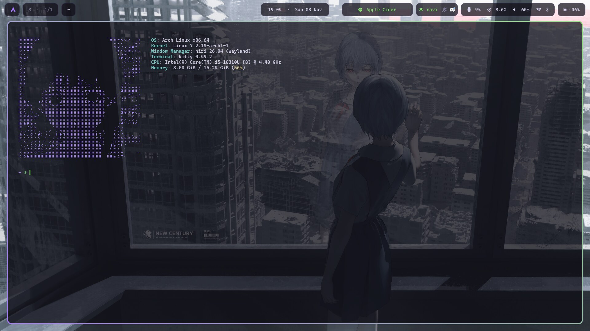
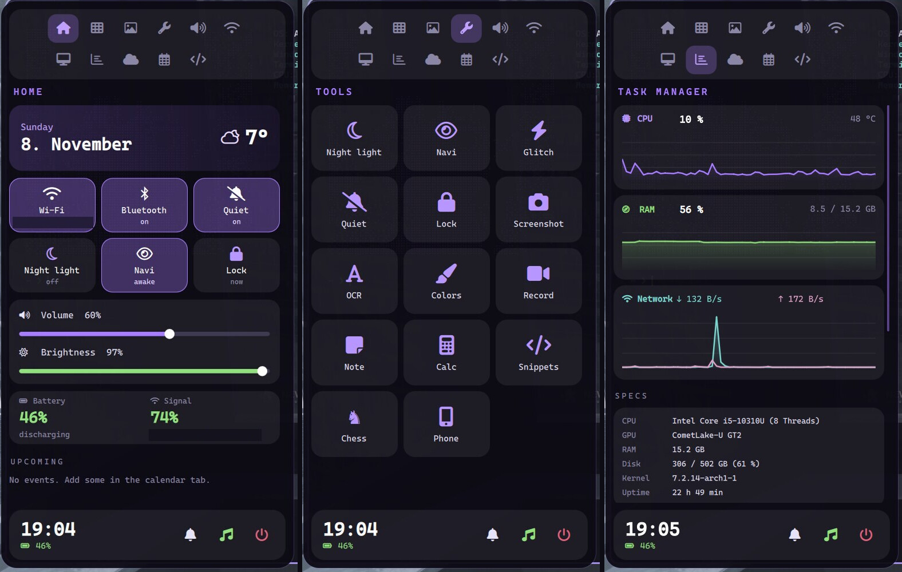
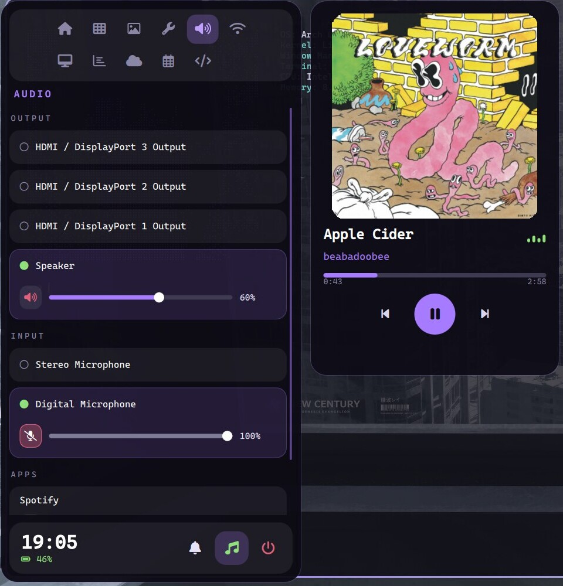

# niri dotfiles

[](https://github.com/tkafka42/dotfiles/actions/workflows/lint.yml)


hyprland sucks and keeps crashing after every system update (`pacman -Syu`) or hyprland update, so i switched to **niri** in hope it's more stable. here are my dotfiles for anyone who likes the looks.

aesthetically it's inspired by my fav shows, evangelion and lain, just subtle tho lol. enjoy.

what i tried to do: nothing too crazy (no wild animations, no feature creep), nice looking, and actually useful for developing. that's important to me, a setup i like looking at is a big part of my working motivation lol.

it's also pretty light: with the sidebar closed, the whole shell (bar, notifications, wallpaper daemon, scripts) sits around 75 MB, plus niri itself (~175 MB). i haven't benchmarked it against hyprland, those are just my numbers.

**if you have ricing tips, please let me know!** open an issue or a PR, i'm still learning and happy about any suggestions.



> **niri** + **waybar** + a **quickshell** sidebar, dark glass, purple/green accents. Arch Linux, Wayland.


## table of contents

- [the fun part: the sidebar](#the-fun-part-the-sidebar)
- [keybinds](#keybinds)
- [install](#install)
- [what it needs (arch)](#what-it-needs-arch)
- [heads up](#heads-up)
- [layout](#layout)

## the fun part: the sidebar

`Super+Space` slides in a sidebar with 11 tabs: **home, apps, wallpapers, tools, audio, internet, monitor, task manager, weather, calendar, dev**. It's written in QML for [quickshell](https://quickshell.org), no extra daemons.



`Super+M` opens a now-playing card next to it (works with anything that speaks MPRIS, spotify included):



some things i'm kinda proud of:

- **internet tab** shows latency to the router *and* the internet with a quality rating, plus all wifi networks with signal bars
- **task manager** tab has live cpu / ram / network graphs, specs and a kill button per process
- **monitor tab** has projector modes (extend / mirror / laptop only / external only), scale, rotation, position
- **volume / brightness OSD** that still shows up when notifications are on do-not-disturb
- **`Super+Ctrl+Left/Right`** keeps going into the next workspace when you hit the end of the columns, so you never get stuck
- tiny scripts for ocr (copy text from anywhere on screen), annotated screenshots, a project switcher, snippets, a dev calculator (hex/bin), a chess menu (stockfish + lichess daily puzzle) and optional glitch window animations

## keybinds

`Super` is the mod key. `Super+/` shows the full list on screen.

| keys | what |
|---|---|
| `Super+Space` | sidebar on/off |
| `Super+M` | music card on/off |
| `Super+A` | app launcher (rofi) |
| `Super+Tab` | window picker, numbered `workspace.column` |
| `Super+O` | niri overview |
| `Super+T` / `Super+Return` | terminal |
| `Super+Q` | close window |
| `Super+R` | cycle window width: 1/2, 2/3, full |
| `Super+1…9` | jump to column |
| `Super+Ctrl+Left/Right` | go left/right, continues into next/previous workspace |
| `Super+D` | project switcher (vs code + terminal) |
| `Super+S` | snippets to clipboard |
| `Super+Alt+O` | ocr a screen area |
| `Super+Shift+A` | screenshot you can draw on |
| `Super+Alt+C` | calculator |
| `Super+Alt+X` | chess |
| `Super+I` | "navi": keep the laptop awake |
| `Super+N` | do not disturb |
| `Super+Shift+G` | glitch animations on/off |
| `Super+L` | lock |

## install

```bash
git clone https://github.com/tkafka42/dotfiles ~/dotfiles && cd ~/dotfiles
./install.sh      # backs up whatever it replaces, never uses sudo
```

then:

1. drop wallpapers into `~/Pictures/Wallpapers` (a `lock.jpg` in there is used by the lock screen). wallpapers aren't included.
2. add `source ~/.config/zsh/dotfiles.zsh` to your `~/.zshrc` (starship prompt + a few helpers)
3. **change the keyboard layout**, it's `de` in `niri/config.kdl` (`input` → `xkb`)
4. log out, pick niri

## what it needs (arch)

built and used on **niri 26.04**, **quickshell 0.3.2**, waybar 0.15, hyprlock 0.9.

```
niri xwayland-satellite waybar quickshell rofi swaync swayidle hyprlock awww kitty
jq python playerctl brightnessctl wl-clipboard cliphist grim slurp networkmanager bluez
```

optional, each feature tells you which package is missing if you use it without:

```
satty wf-recorder wlsunset tesseract(+data-eng/deu) kdeconnect sshfs cava fastfetch
starship zoxide eza bat fzf lazygit chess-tui stockfish wl-mirror
```

plus the font **CaskaydiaCove Nerd Font**.

## heads up

- some widget text is german in a couple of places, sorry. grep for it if it bugs you.
- it's easy on the cpu and on ram. the quickshell sidebar isn't running all the time: it starts on demand (`scripts/qs-call.sh`, about a quarter of a second) and quits itself after 2 minutes unused. with it closed the whole setup (waybar, swaync, wallpaper daemon, helper scripts) sits around 75 MB; while the sidebar is open add roughly 150 MB. swaync grows over time with your notification history, a restart resets it.
- niri has no blur, so "see-through" windows are plain opacity (`window-rule` in `config.kdl`, 88%). electron apps are excluded because they look off.
- the weather tab defaults to vienna. press the "change city" button.
- the lain ascii logos in `fastfetch/` are from around the internet, authors unknown. delete the folder if you'd rather not ship them.

## layout

```
niri/          compositor config, waybar, rofi, lock screen, all the scripts
quickshell/    the sidebar (shell.qml + one file per tab)
swaync/        notification center
kitty/ starship/ cava/ fastfetch/ zsh/
install.sh     copy everything into ~/.config
sync.sh        (for me) copy changes back from ~/.config into this repo
```

MIT licensed, do whatever. if you make something cool with it, i'd love to see it.
